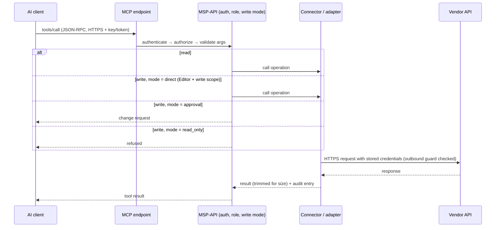
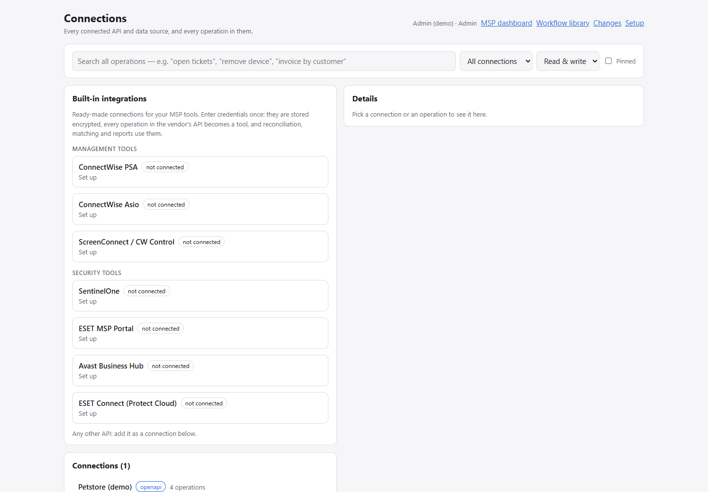
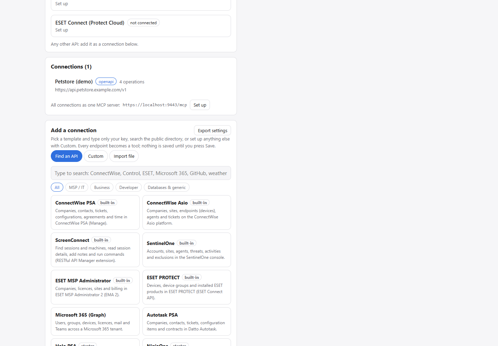
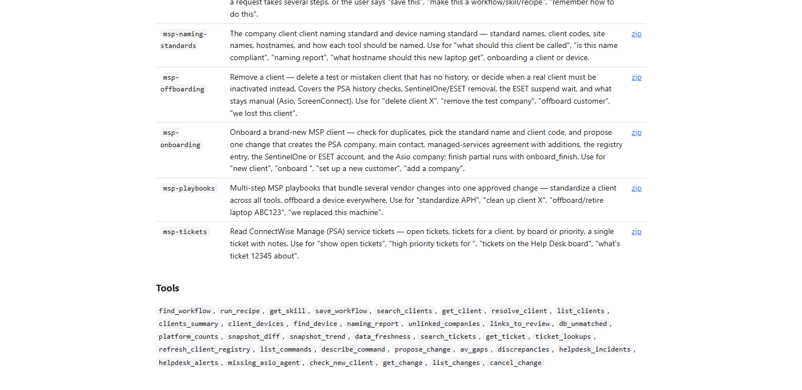
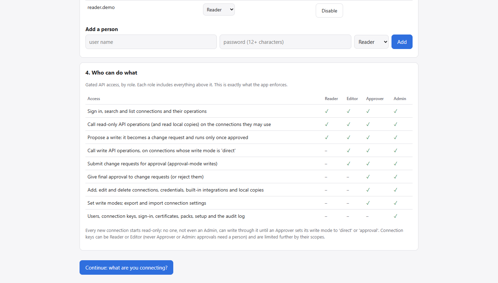
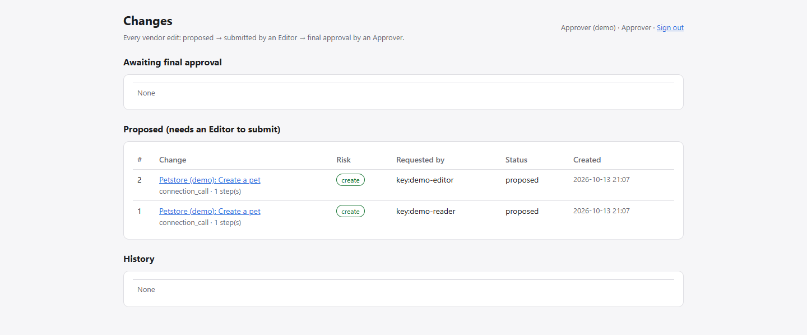
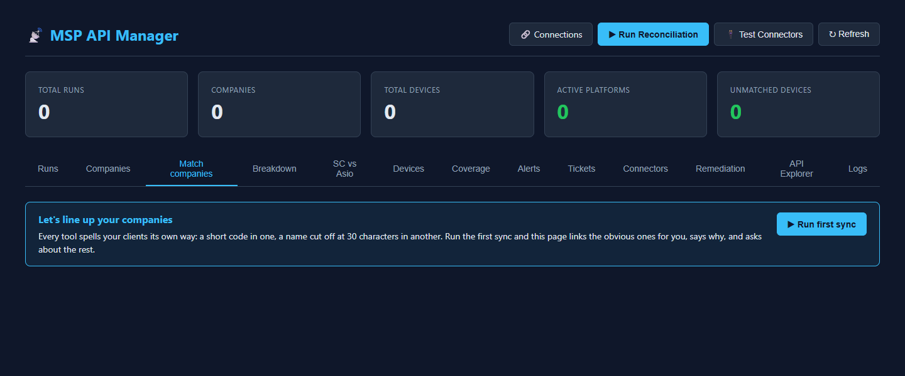

# MSP-API

**Connect AI assistants to your MSP tools and any API, and decide exactly what the AI is allowed to do.**

MSP-API is a self-hosted server that turns ConnectWise PSA, ConnectWise Asio, ScreenConnect, SentinelOne, ESET,
and any API with a definition into [Model Context Protocol](https://modelcontextprotocol.io) (MCP) servers for
Claude, VS Code, Cursor and other AI clients. Every call is signed in, checked against a role, held to a per-API
write mode and recorded in an audit log.

> In the web interface the application calls itself **API Tools**. The optional MSP features are the **MSP pack**.

---

## Contents

- [What is MSP-API?](#what-is-msp-api)
- [Why MSP-API?](#why-msp-api)
- [How It Works](#how-it-works)
- [MCP Server](#mcp-server)
- [/msp Tools](#msp-tools)
- [API Integrations](#api-integrations)
- [Security & Role-Gated Execution](#security--role-gated-execution)
- [Screenshots](#screenshots)
- [MCP Tools](#mcp-tools)
- [Installation](#installation)
- [Configuration](#configuration)
- [Connecting an MCP Client](#connecting-an-mcp-client)
- [Example Workflows](#example-workflows)
- [Repository Structure](#repository-structure)
- [Security](#security)
- [Project Status](#project-status)
- [Contributing](#contributing)
- [Support the Project](#support-the-project)
- [Disclaimer](#disclaimer)
- [License](#license)

---

## What is MSP-API?

AI assistants are useful for MSP work: finding a client's machines, checking antivirus coverage, reading tickets,
or drafting a fix. But giving an AI client your PSA or RMM API keys gives it everything those keys can do,
including deleting things.

MSP-API sits between the AI client and your platforms:

- **The AI never sees vendor credentials.** They are stored encrypted on the server (AES-256-GCM).
- **The AI only gets tools.** It doesn't get raw API access. Each tool call is authenticated, authorized against the caller's role, and audited.
- **Writes are controlled per API.** Each API's write mode decides whether writes are refused, run directly, or held for
  human approval.

It does four different kinds of things, and treats each one differently:

| Kind | Example | How it is controlled |
|---|---|---|
| **Reading / querying** | "Which machines at this client have no antivirus?" | Any signed-in role with read scope for that API |
| **Modifying information** | Rename a client in PSA, add a ticket note | The API's write mode: refused, run directly (Editor+), or turned into a change request |
| **Executing API actions** | Decommission a SentinelOne agent, offboard a device everywhere | A change request: proposed by anyone, **submitted by an Editor, approved by an Approver** (both signed-in people) |
| **Role/permission-gated MCP tools** | `refresh_client_registry`, `propose_change` | Checked on the server when the tool is *called*, not only hidden in a UI |

## Why MSP-API?

- **One place to connect AI to everything.** Built-in integrations for the common MSP stack, plus any OpenAPI, Swagger,
  Postman, cURL, SOAP, GraphQL, OData, SQL, MongoDB or remote MCP source.
- **Safe by default.** Every new connection starts **read-only**. Nobody, not even an Admin, can write through it
  until an Approver changes its write mode.
- **Human approval for risky work.** AI clients can *propose* changes but can't run them. A change shows the exact
  requests and the current state before anyone approves it.
- **Cross-tool MSP answers** (MSP pack). The client registry, company matching, reconciliation, antivirus gaps and
  discrepancies come from data synced into the server's own database, so the AI answers quickly without calling every vendor.
- **Large APIs stay usable.** Each API is searched first (`search_operations`), so an API with thousands of endpoints
  doesn't flood the AI's context.
- **Self-hosted.** Runs on one machine with SQLite, or Docker with PostgreSQL. Your data stays on your server.

---

## How It Works

```mermaid
flowchart LR
    AI["AI client<br/>(Claude, VS Code, Cursor)"]

    subgraph Server["MSP-API server (FastAPI)"]
        direction TB
        MW["NetworkBoundaryMiddleware<br/>app/security.py"]
        AUTH["Authentication<br/>session · connection key · OAuth token<br/>app/auth/principal.py → resolve()"]
        AUTHZ["Authorization<br/>role rank + scopes + CSRF<br/>_authorize()"]
        MCP["MCP servers<br/>/mcp · /mcp/{connection} · /msp/mcp<br/>app/mcp/ · app/api/org_mcp.py"]
        TOOL["Tool call<br/>role check · argument validation"]
        WM["Write mode<br/>read_only · direct · approval<br/>app/auth/write_mode.py"]
        CHG["Change requests<br/>Editor submits → Approver approves<br/>app/services/changes.py"]
        CONN["API connectors<br/>adapters (any API) · vendor connectors<br/>app/connections/ · app/connectors/"]
        NG["Outbound guard<br/>app/connections/netguard.py"]
        AUD[("Audit log<br/>+ encrypted credentials")]
    end

    VENDOR["External APIs<br/>PSA · Asio · ScreenConnect<br/>SentinelOne · ESET · any API"]

    AI -->|"JSON-RPC over HTTPS"| MW --> AUTH --> AUTHZ --> MCP --> TOOL
    TOOL -->|read| CONN
    TOOL -->|write| WM
    WM -->|direct| CONN
    WM -->|approval| CHG -->|after final approval| CONN
    CONN --> NG --> VENDOR
    TOOL -.-> AUD
    CONN -.-> AUD
```



1. **Network boundary.** Requests whose `Host` isn't a LAN address, a single-label LAN name or the configured edge domain are
   refused, which blocks tunnels. Internet traffic must come through the nginx edge (`X-MSP-Edge: 1`). From
   outside the office, it can reach only the MCP endpoints and OAuth discovery, registration and token endpoints.
2. **Authentication.** Every route except health, sign-in, first-run setup and OAuth discovery needs a caller:
   a browser session, a connection key (`msp_…`) or an OAuth access token. Requests without one get `401`.
3. **Authorization.** Role rank, scopes and CSRF are checked before the route runs.
4. **MCP tool.** The tool validates its arguments and checks the caller's role.
5. **Write mode.** Every write passes the target API's write mode.
6. **Connector.** The request goes out through the connector, after the outbound guard checks the destination address.
7. **Audit.** Tool calls and writes are recorded. Arguments are stored as a hash, never in plain text.

---

## MCP Server

| | |
|---|---|
| **Implementation** | [`app/mcp/protocol.py`](app/mcp/protocol.py): MCP on JSON-RPC 2.0, with no dependency on the `mcp` SDK. Protocol versions `2025-11-25`, `2025-06-18`, `2025-03-26`, `2024-11-05` |
| **Transport** | Streamable HTTP, **stateless**, JSON responses. `POST` only. `GET`/`DELETE` return `405` (no SSE stream, no sessions). Requests must be `Content-Type: application/json` |
| **Starts with** | The web app itself: `python -m app.cli run` or uvicorn `app.main:app`. There is no separate MCP process |
| **Core servers** | [`app/api/mcp_servers.py`](app/api/mcp_servers.py) routes. [`app/mcp/servers.py`](app/mcp/servers.py) builds the tools |
| **MSP server** | [`app/api/org_mcp.py`](app/api/org_mcp.py) (MSP pack only) |
| **stdio bridge** | [`app/mcp/stdio_bridge.py`](app/mcp/stdio_bridge.py), served at `GET /mcp/bridge.py`, for clients that only start local stdio servers |

### Endpoints

| URL | Server | Tools registered in |
|---|---|---|
| `POST /mcp` | **Hub:** every connection your scopes allow | `hub_server()`: `app/mcp/servers.py` |
| `POST /mcp/{connection}` | One connection as its own MCP server | `connection_server()`: `app/mcp/servers.py` |
| `POST /mcp/{connection}/{group}` | A hand-picked group of that connection's operations | `connection_server(…, group)` |
| `POST /msp/mcp` | The MSP pack's curated tools, org skills as prompts | `TOOLS`: `app/api/org_mcp.py` |
| `GET /api/mcp/servers` | Every server you may use, with ready-to-paste client configs | `app/api/mcp_servers.py` |

### How tools reach the APIs

- **Core servers** call `service.call_operation()` ([`app/connections/service.py`](app/connections/service.py)).
  That function checks read scope, validates the arguments against the operation's JSON Schema, applies the write mode,
  runs the adapter for that kind of API and writes the audit record.
- **`/msp/mcp`** calls the app's own REST API **in-process, as the original caller** (`_internal()` with
  `internal_headers()`). The call goes back through the same middleware, so the REST API's role checks apply to AI
  calls exactly as they do to people. The internal header is an HMAC-derived secret, and the middleware rejects it if it arrives through the edge.

### Authentication for MCP

| Credential | How it is sent | Notes |
|---|---|---|
| Connection key | `X-API-Key: msp_…` or `Authorization: Bearer msp_…` | Created by an Admin. Role **Reader or Editor only**, never Approver or Admin. Scopes `<connection\|*>:<read\|write>`, optional expiry. Stored as a hash |
| OAuth 2.1 token | `Authorization: Bearer …` | Dynamic client registration, authorization code + PKCE (S256), rotating refresh tokens (access 1 h, refresh 60 days). **Bound to the one MCP server it was issued for** (RFC 8707 `resource`), so a token for `/mcp/a` is refused at `/mcp/b` |
| Browser session | Cookie | For people using the web interface |

Unauthenticated MCP requests get `401` with a `WWW-Authenticate` header pointing at the server's
`/.well-known/oauth-protected-resource` metadata (RFC 9728), so OAuth-capable clients can discover how to sign in.

### Role and permission enforcement

Enforced on the server, at four layers:

1. **Middleware** (`app/security.py → _authorize`): admin paths need Admin or Approver; connection management needs Approver;
   other non-GET API calls need Editor and a `write` scope.
2. **Scopes** (`Principal.allows`): the core MCP servers list and call only the connections the credential's scopes allow, and the MSP pack (`/msp/mcp` and its API) needs a `*:read` or `*:write` scope.
3. **Tool call** (`org_mcp._handle`): `/msp` tools that change data need Editor. Proposal tools are open to all roles.
4. **Write mode and change engine** (`app/auth/write_mode.py`, `app/services/changes.py`).

---

## /msp Tools

`/msp/mcp` is the **MSP pack's** MCP server: a curated set of tools for MSP work over data the server keeps in
its own database. It is a **separate MCP server** from the per-connection ones. It exists only when the MSP pack
is enabled (`MSP_PACKS=msp`, or chosen in **Get started**). Without the pack, `/msp/mcp` returns `404`.

| | |
|---|---|
| Location | [`app/api/org_mcp.py`](app/api/org_mcp.py), registered by [`app/packs/msp/__init__.py`](app/packs/msp/__init__.py) |
| URL | `POST https://<your-server>/msp/mcp` |
| Setup page | `GET /msp/connect`: install commands for Claude Code, VS Code and Claude Desktop |
| Also serves | Org skills ([`app/org_skills/`](app/org_skills/)) as MCP prompts, recipes ([`app/org_recipes/`](app/org_recipes/)), playbooks ([`app/org_playbooks/`](app/org_playbooks/)) |

**35 tools** in five groups (complete table: [docs/MCP_TOOLS.md](docs/MCP_TOOLS.md)):

| Group | Tools | Needs |
|---|---|---|
| Workflow library | `find_workflow`, `run_recipe`, `get_skill`, `save_workflow` | Reader (`save_workflow` only proposes) |
| Clients, devices, coverage | `search_clients`, `get_client`, `resolve_client`, `list_clients`, `clients_summary`, `client_devices`, `find_device`, `naming_report`, `unlinked_companies`, `links_to_review`, `db_unmatched`, `platform_counts`, `snapshot_diff`, `snapshot_trend`, `data_freshness`, `av_gaps`, `missing_asio_agent`, `discrepancies`, `check_new_client` | Reader |
| Registry refresh | `refresh_client_registry` | **Editor** + write scope |
| Live vendor reads | `search_tickets`, `get_ticket`, `ticket_lookups`, `helpdesk_incidents`, `helpdesk_alerts` | Reader |
| Changes | `list_commands`, `describe_command`, `propose_change`, `get_change`, `list_changes`, `cancel_change` | Reader to propose. **Editor submits, Approver approves** |

### How execution is blocked

Every role sees the **same tool list**. The tools aren't hidden by role; they are **refused when called**. The
responses below are real, recorded from a demo install with no vendor credentials:

```jsonc
// Reader key → tools/call refresh_client_registry
{"result": {"content": [{"type": "text", "text": "refresh_client_registry requires the Editor role"}], "isError": true}}

// Editor key → tools/call refresh_client_registry  (runs)
{"result": {"content": [{"type": "text", "text": "{\"sync\": {}, \"auto_link\": {\"status\": \"no_anchor\", …}}"}], "isError": false}}

// Core-only install (no MSP pack) → POST /msp/mcp
HTTP 404 {"detail": "Not Found"}

// No credential → POST /mcp
HTTP 401
```

`propose_change` never executes anything. It returns a change number and an approval link. Submitting requires
a signed-in person with the Editor role, and final approval requires a signed-in Approver. Connection keys and OAuth
tokens can't do either (`require_role()` in `app/api/auth_m365.py` only accepts browser sessions).

---

## API Integrations

### Request flow



### Built-in MSP integrations (MSP pack)

Implemented in [`app/connectors/`](app/connectors/) and listed as connections of kind `builtin`
([`app/services/builtin_integrations.py`](app/services/builtin_integrations.py)). Credentials come from the web
interface (stored encrypted) or `.env`.

| Integration | Connector | Authentication method |
|---|---|---|
| ConnectWise PSA (Manage) | `connectwise_psa.py` | HTTP Basic (company + public/private key) and `clientId` header |
| ConnectWise Asio | `asio.py` | OAuth 2.0 client credentials (JSON body) |
| ScreenConnect (RESTful API Manager extension) | `screenconnect.py` | Custom `CTRLAuthHeader` secret |
| SentinelOne | `sentinelone.py` | `Authorization: ApiToken …` |
| ESET MSP Administrator 2 | `eset.py` | Username/password → bearer JWT |
| ESET PROTECT / ESET Connect | `eset_connect.py` | OAuth 2.0 password grant (used for per-device antivirus detail) |
| Avast Business Hub | `avast.py` | OAuth 2.0 client credentials |

### Any API (core)

Adapters in [`app/connections/adapters/`](app/connections/adapters/). Add an API from its definition, and every
operation in it becomes searchable and callable.

| Kind | Source | Operations |
|---|---|---|
| OpenAPI 3 / Swagger 2 | URL, file or pasted text | Every endpoint |
| Postman | Collection v2.0 / 2.1 | Every request |
| cURL | One or more `curl` commands | Each command |
| SOAP | WSDL | Every operation |
| GraphQL | Endpoint (introspection) or schema | Queries and mutations |
| OData | Service URL or `$metadata` (V2, V4) | Entity sets and functions |
| SQL | Connection string | Read-only tables, columns and queries |
| MongoDB | Connection string | Read-only find, count and aggregate |
| MCP | Another MCP server's URL | Its tools, behind this server's sign-in and audit |

**Authentication types** for connections ([`app/connections/http.py`](app/connections/http.py) `AUTH_TYPES`): none,
API key (header or query), HTTP Basic, bearer token, custom headers, OAuth 2.0 client credentials, OAuth 2.0
password grant, token login, and WS-Security (SOAP).

**Templates.** About 40 ready-made templates ([`app/connection_templates/templates.yaml`](app/connection_templates/templates.yaml))
cover the MSP tools above plus Microsoft Graph, Autotask, Halo PSA, NinjaOne, IT Glue, Hudu, Huntress, Pax8, Meraki,
Auvik, KnowBe4, Stripe, HubSpot, Salesforce, Xero, Shopify, Zendesk, Freshdesk, GitHub, GitLab, Jira, Confluence,
Slack, Notion, Asana, Trello and databases. Some vendors don't publish a definition; those templates ship a small
**starter** definition of common read endpoints. You can also search the public
[APIs.guru](https://apis.guru) directory from the picker, and export or import connection settings (never secrets).

---

## Security & Role-Gated Execution

**Authentication answers "who are you?"** Every request resolves to one caller: a person signed in with Microsoft 365,
another OpenID Connect provider, or a local account (scrypt password + mandatory TOTP authenticator); or a
connection key; or an OAuth token.

**Authorization answers "what are you allowed to do?"** That depends on the caller's **role**, the credential's **scopes**, and the
target API's **write mode**.

### Roles

Four roles, each including everything below it. The table matches the `ACCESS` list in
[`app/auth/principal.py`](app/auth/principal.py) that the app shows in **Get started**, and [`tests/test_roles.py`](tests/test_roles.py) checks every row against the real
endpoints for every role.

| Capability | Reader | Editor | Approver | Admin |
|---|:---:|:---:|:---:|:---:|
| **Read:** sign in, search and list connections and their operations | ✅ | ✅ | ✅ | ✅ |
| **Read:** call read-only API operations and read local copies (connections in scope) | ✅ | ✅ | ✅ | ✅ |
| **Create (proposal):** propose a write; it becomes a change request and runs only once approved | ✅ | ✅ | ✅ | ✅ |
| **Modify:** call write operations on connections whose write mode is `direct` | — | ✅ | ✅ | ✅ |
| **Execute:** submit change requests for approval | — | ✅ | ✅ | ✅ |
| **Execute:** give final approval to change requests, or reject them | — | — | ✅ | ✅ |
| **Create/modify:** add, edit and delete connections, credentials, built-in integrations and local copies | — | — | ✅ | ✅ |
| **Modify:** set write modes; export and import connection settings | — | — | ✅ | ✅ |
| **Admin:** users, connection keys, sign-in, certificates, packs, setup and the audit log | — | — | — | ✅ |

Roles come from Entra app roles, OIDC claims (mappable with `MSP_OIDC_ROLE_MAP`), local accounts or connection
keys. Older names (`MSPTools.User`, `MSPTools.Editor`, `MSPTools.Approver`, `MSPTools.Admin`) are still accepted.

### Write modes

Set per API by an Approver ([`app/auth/write_mode.py`](app/auth/write_mode.py)). The default is `read_only`.

| Mode | Writes |
|---|---|
| `read_only` | Refused for everyone, including already-approved changes |
| `direct` | Run immediately for Editor+ with a `write` scope for that API |
| `approval` | Become change requests. An Editor submits, an Approver approves |

### Change requests

[`app/services/changes.py`](app/services/changes.py)

- A change stores the exact steps and a hash of them. It is refused at approval if the content changed.
- Before running, the current state is read again. If the target changed since the preview, the change is marked
  **stale** and nothing runs.
- Changes rated `delete` require typing `DELETE` when submitting.
- Submit and approve need a **signed-in person** with a CSRF token. Keys and OAuth tokens can't approve.
- Only the requester can cancel a proposed change.

### Verified controls

| Control | Where |
|---|---|
| Every route authenticated, including on the LAN | `app/security.py` |
| Network boundary: tunnel/unknown hosts refused; internet traffic only through the edge, limited to MCP + OAuth | `app/security.py` |
| CSRF check on browser-session writes | `app/security.py`, `app/api/auth_m365.py` |
| Rate limits per caller (default 600/min) and per IP on sign-in endpoints (60/min) | `app/auth/ratelimit.py` |
| Vendor credentials encrypted at rest (AES-256-GCM, `MSP_MASTER_KEY`) | `app/auth/crypto.py` |
| Connection keys and OAuth tokens stored as SHA-256 hashes | `app/api/external_auth.py` |
| Local passwords hashed with scrypt; TOTP with replay protection and lockout | `app/auth/passwords.py`, `app/api/auth_local.py` |
| OAuth tokens bound to one MCP server; redirect URIs allow-listed | `app/api/external_auth.py`, `app/security.py` |
| Outbound guard: no link-local or cloud-metadata targets; optional block of private ranges | `app/connections/netguard.py` |
| Audit log of every write and every MCP tool call (arguments hashed) | `app/auth/audit.py` |

More detail: [docs/SECURITY.md](docs/SECURITY.md).

---

## Screenshots

All screenshots come from a demo install with placeholder users, a sample "Petstore" API and **no vendor
credentials**. How to capture the rest: [SCREENSHOTS.md](SCREENSHOTS.md).

### Main interface: Connections


### API and integration configuration


### /msp tools


### MCP with /msp tools available
<!-- Capture per SCREENSHOTS.md → mcp-with-msp-tools.png -->
_Screenshot pending: `docs/images/mcp-with-msp-tools.png`. An MCP client connected to `/msp/mcp`, listing the 35 MSP tools._

### MCP without /msp tools available
<!-- Capture per SCREENSHOTS.md → mcp-without-msp-tools.png -->
_Screenshot pending: `docs/images/mcp-without-msp-tools.png`. The same client against a core-only install: `/msp/mcp` returns 404, and the hub `/mcp` offers only the four core tools._

### Roles and permissions


### Change approvals


### MSP dashboard (MSP pack)


---

## MCP Tools

Core tools on every install:

| Tool | Integration | Purpose | Read/Write/Execute | Required permission |
|---|---|---|---|---|
| `list_connections` | Hub | Connections you may use, with write mode and MCP URL | Read | Reader |
| `search_operations` | Any connection | Find operations by intent | Read | Reader |
| `describe_operation` | Any connection | Argument schema of one operation | Read | Reader |
| `call_operation` | Any connection | Run one operation | Execute (read, or write per write mode) | Reader for reads; writes per write mode |
| `search_records` / `get_record` | Local copies | Search synced data without calling the API | Read | Reader |
| *pinned operations* | One connection | Typed tool per pinned operation | Read or Execute | As `call_operation` |

MSP pack (`/msp/mcp`), summarized above in [/msp Tools](#msp-tools). It also includes 25 change commands
(tickets, naming, PSA configurations, antivirus remediation, onboarding, offboarding, playbooks) that can be
**proposed** but only run after approval.

**Complete list with every tool, command and permission: [docs/MCP_TOOLS.md](docs/MCP_TOOLS.md).**

---

## Installation

### Prerequisites

- **Python 3.12+** for the single-machine install, or **Docker** with Docker Compose for a shared server
- Windows, macOS or Linux
- For the MSP pack: API credentials for the vendors you use (entered in the web interface)

### Option A: this computer, no Docker

```bash
git clone https://github.com/practicinglife/MSP-Api-new.git
cd MSP-Api-new
pip install -r requirements.txt
python -m app.cli run
```

`run` prepares whatever isn't configured and starts the server at `https://localhost`:
- a SQLite database and a generated encryption key in `data/` (back this folder up; keep `data/master.key` secret)
- a local certificate authority and HTTPS certificate in `certs/`

It prints a **setup code**. Open the address, enter the code, and create the first administrator (password +
authenticator QR code). The **Get started** wizard then walks you through:

1. **Your login.**
2. **Secure it.** The permanent address and certificate (Let's Encrypt via a DNS record, or upload your own), sign-in
   (Microsoft 365, another OpenID Connect provider, or local accounts) and people.
3. **What you're connecting.** The MSP path (built-in tools, first sync, company matching) or Any API path (connect,
   pick tools, add to your AI client).

Until the **Secure it** step is finished, the server answers on every network interface, so setup can be done from
another computer. The banner prints this computer's addresses, and the local certificate includes them. After
that step it listens where you chose: the network, or this computer only. Windows Firewall may still need to
allow the port.

Useful flags: `--port`, `--host` (overrides the listen address), `--data <folder>`, `--packs msp|none`,
`--sqlite`, `--no-sso`.

To make browsers trust the local certificate, trust `certs/ca.crt` once. On Windows:

```bash
certutil -user -addstore Root certs\ca.crt
```

### Option B: Docker and PostgreSQL (shared server)

```bash
git clone https://github.com/practicinglife/MSP-Api-new.git
cd MSP-Api-new
cp .env.example .env
```

Edit `.env`: set `POSTGRES_PASSWORD`, use the same password in `DATABASE_URL`, and set `MSP_MASTER_KEY`:

```bash
python -m app.cli gen-master-key
```

Then start it and get the setup code:

```bash
docker compose -f docker-compose.yml -f docker-compose.prod.yml up -d --build
```

```bash
docker compose exec app python -m app.cli setup-code
```

Open `https://<server>:8000/setup`. The container serves HTTPS only, the same way as Option A: a local CA certificate (set `MSP_CERT_NAMES=<server-name>,<server-ip>` in `.env` so it names the server) until **Secure it** installs a trusted one. Full guide: [docs/INSTALL.md](docs/INSTALL.md). Internet access for MCP
through nginx: [deploy/edge/README.md](deploy/edge/README.md).

---

## Configuration

Settings come from `.env` (template: [`.env.example`](.env.example)) or from the **Get started** wizard (saved in
`data/settings.json`). Values in `.env` always win.

| Setting | Purpose |
|---|---|
| `DATABASE_URL` | PostgreSQL (or SQLite) connection string |
| `MSP_MASTER_KEY` | Key that encrypts stored credentials. Generate with `python -m app.cli gen-master-key` and keep it out of the database backups |
| `MSP_PACKS` | `msp` to turn on the MSP pack; empty for core only |
| `MSP_EXTERNAL_BASE_URL` / `MSP_PUBLIC_BASE_URL` | The address AI clients and OAuth use |
| `MSP_ENTRA_*` / `MSP_OIDC_*` | Single sign-on (Microsoft 365 or any OpenID Connect provider), role claim mapping |
| `MSP_WRITE_MODE_DEFAULT`, `MSP_WRITE_MODE_<API>` | Starting write modes (default `read_only`) |
| `MSP_BLOCK_PRIVATE_TARGETS` | Refuse connections to private and loopback addresses |
| `MSP_RATE_LIMIT_PER_MIN`, `MSP_RATE_LIMIT_ANON_PER_MIN` | Rate limits |
| `MSP_EDGE_DOMAIN`, `MSP_OFFICE_IPS` | Internet edge name, and addresses treated as the office |
| `MSP_API_DIRECTORY` | `off` disables the public API directory search |
| `MSP_CERT_NAMES` | Extra names and addresses for the local HTTPS certificate (e.g. the Docker host) |

Vendor credentials for the MSP pack can be set in `.env` (see `.env.example`). It's better to enter them in
**Connections → Built-in integrations**, where they are stored encrypted. Admin commands:

```bash
python -m app.cli --help
```

---

## Connecting an MCP Client

1. **Get a credential.** An Admin creates a connection key (Reader or Editor, with scopes):

   ```bash
   python -m app.cli create-key "Pat - laptop" --role reader --scope "*:read" --expires-days 365
   ```

   Or, for claude.ai connectors, sign in with OAuth (the client discovers it automatically).

2. **Pick a server URL:** `https://<your-server>/mcp` (hub), `/mcp/<connection>`, or `/msp/mcp` (MSP pack).
   **Connections → Use with AI clients** shows each one with ready-to-paste setups.

3. **Add it to your client.**

   Claude Code:
   ```bash
   claude mcp add --transport http apis https://<your-server>/mcp --header "X-API-Key: <your connection key>"
   ```

   VS Code (`.vscode/mcp.json`):
   ```json
   {
     "inputs": [{"id": "msp-key", "type": "promptString", "description": "Connection key", "password": true}],
     "servers": {"apis": {"type": "http", "url": "https://<your-server>/mcp",
                          "headers": {"X-API-Key": "${input:msp-key}"}}}
   }
   ```

   Cursor (`mcp.json`):
   ```json
   {"mcpServers": {"apis": {"url": "https://<your-server>/mcp", "headers": {"X-API-Key": "<your connection key>"}}}}
   ```

   Claude Desktop (local stdio bridge, download from `/mcp/bridge.py`):
   ```json
   {"mcpServers": {"apis": {"command": "python", "args": ["<folder>/mcp-bridge.py", "https://<your-server>/mcp"],
                            "env": {"MSP_API_KEY": "<your connection key>"}}}}
   ```

   For the MSP pack, `/msp/connect` has one-line installers for Claude Code (a plugin with the org skills) and
   Claude Desktop.

More: [docs/MCP-CLIENTS.md](docs/MCP-CLIENTS.md).

---

## Example Workflows

**"Which machines at Contoso have no antivirus?"** (MSP pack, Reader)
The assistant calls `search_clients` → `av_gaps` with the client code. The answer comes from the last antivirus sweep
in the server's database. No vendor is called and nothing changes.

**"Show open tickets for this client"** (MSP pack, Reader)
`search_clients` → `search_tickets` with a conditions string. A live, read-only call to ConnectWise PSA.

**"Offboard laptop CON-LT-042"** (MSP pack)
`find_workflow` finds the `offboard-device` playbook, and `propose_change` builds a plan with the exact SentinelOne,
Asio and PSA requests and their current state. The assistant returns a link. **Nothing runs** until an Editor
submits it and an Approver approves it in the browser. The state is checked again just before it runs.

**"Create an issue in our GitHub repo"** (any API)
On the hub, `search_operations("create issue")` → `describe_operation` → `call_operation`. If the connection is
`read_only`, the call is refused. If it is `approval`, it becomes change request #n. If it is `direct` and the caller is an Editor with write
scope, it runs.

---

## Repository Structure

```text
app/
  main.py                 FastAPI app: core routers, packs, middleware
  security.py             Network boundary, authentication, authorization, audit
  cli.py                  Admin commands (run, create-user, create-key, make-certs, …)
  auth/                   Roles and principals, write modes, encryption, passwords/TOTP, rate limits, audit
  mcp/                    MCP protocol, per-connection and hub servers, stdio bridge
  api/                    HTTP routes (connections, MCP, changes, setup, sign-in, MSP pack features)
  connections/            Any-API engine: adapters, search, local-copy sync, outbound guard
  connectors/             Built-in vendor connectors (PSA, Asio, ScreenConnect, SentinelOne, ESET, Avast)
  services/               Change engine and commands, company matching, reconciliation, templates, TLS
  packs/msp/              The MSP pack: what it registers and starts
  connection_templates/   Connection templates and starter API definitions
  org_skills/ org_recipes/ org_playbooks/   Org library served through /msp/mcp
  static/                 Web interface
alembic/                  Database migrations
deploy/                   Server setup scripts, nginx edge
docs/                     Install, security, connecting APIs, MCP clients, MCP tool reference, images
tests/                    Offline test suite (network calls are mocked)
```

---

## Security

- **Report vulnerabilities privately** to the maintainers rather than in a public issue.
- **Never commit `.env`, `data/` or `certs/`.** They hold credentials, the encryption key and private keys. They are
  in `.gitignore`.
- Keep `MSP_MASTER_KEY` separate from database backups. Anyone with both can decrypt the stored credentials.
- Give connection keys the narrowest role and scopes that work, and an expiry. Revoking a key also revokes
  every OAuth token issued from it.
- Start every API `read_only`. Use `approval` for vendors where a mistake is expensive.
- Expose only the MCP endpoints to the internet, through the nginx edge in [deploy/edge](deploy/edge/README.md).

---

## Project Status

Active development. The core (any-API connections, MCP servers, roles, write modes, change approvals, audit) and the
MSP pack are working and covered by an offline test suite. Interfaces and the database schema may still change
between versions. Migrations are included.

```bash
pip install -r requirements.txt -r requirements-dev.txt
pytest
ruff check app tests
```

---


---

## Disclaimer

MSP-API is provided "as is", without warranty of any kind. It can change data in the systems you connect it to.
You are responsible for the credentials you configure, the roles and write modes you assign, and every change
you approve. Test against non-production tenants first. ConnectWise, ScreenConnect, SentinelOne, ESET, Avast,
Microsoft and other product names are trademarks of their respective owners. This project is not affiliated with
or endorsed by them.

## License

MIT. See [LICENSE.txt](LICENSE.txt).
