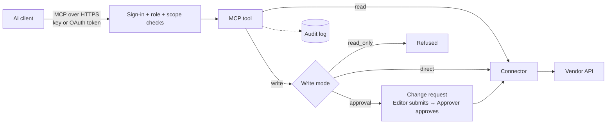

# MSP-API

**Connect AI assistants to your MSP tools and any API, and decide exactly what the AI is allowed to do.**

MSP-API is a self-hosted server that turns ConnectWise PSA, ConnectWise Asio, ScreenConnect, SentinelOne, ESET,
and any API with a definition into [Model Context Protocol](https://modelcontextprotocol.io) (MCP) servers for
Claude, VS Code, Cursor and other AI clients. Every call is signed in, checked against a role, held to a per-API
write mode and recorded in an audit log.

> In the web interface the application calls itself **API Tools**. The optional MSP features are the **MSP pack**.


## Why MSP-API?

Giving an AI client your PSA or RMM API keys gives it everything those keys can do, including deleting things.
MSP-API sits in between:

- **The AI never sees vendor credentials.** They are stored encrypted on the server (AES-256-GCM).
- **The AI only gets tools**, and every tool call is authenticated, checked against the caller's role, and audited.
- **Safe by default.** Every new connection starts **read-only**. Nobody, not even an Admin, can write through it
  until an Approver changes its write mode.
- **Human approval for risky work.** AI clients can *propose* changes but can't run them. A change shows the exact
  requests and current state, and runs only after an **Editor submits** it and an **Approver approves** it.
- **Any API, not just MSP tools.** OpenAPI, Swagger, Postman, cURL, SOAP, GraphQL, OData, SQL, MongoDB or another MCP
  server, with about 40 ready-made templates.
- **Self-hosted, HTTPS only.** One machine with SQLite, or Docker with PostgreSQL.

| What the AI does | Example | How it is controlled |
|---|---|---|
| **Reads** | "Which machines at this client have no antivirus?" | Any signed-in role with read scope for that API |
| **Modifies** | Add a ticket note, rename a client | The API's write mode: refused, run directly (Editor+), or turned into a change request |
| **Executes actions** | Offboard a device everywhere | A change request: submitted by an Editor, approved by an Approver (signed-in people only) |

## How it works



The MCP servers are part of the web app (no separate process), speaking streamable HTTP:

| URL | Serves |
|---|---|
| `/mcp` | Hub: `list_connections`, `search_operations`, `describe_operation`, `call_operation` across every API you may use |
| `/mcp/<connection>` | One API as its own MCP server, plus any operations you pin as tools of their own |
| `/msp/mcp` | MSP pack: 35 curated tools (client registry, devices, antivirus gaps, discrepancies, tickets, change proposals) |

Permissions are enforced **on the server when a tool is called**, not by hiding tools. For example, a Reader
calling `refresh_client_registry` gets `requires the Editor role`, and `/msp/mcp` returns `404` when the MSP pack
is off.

Details, diagrams and source paths: **[docs/ARCHITECTURE.md](docs/ARCHITECTURE.md)**. Every tool and the permission
it needs: **[docs/MCP_TOOLS.md](docs/MCP_TOOLS.md)**.

## Roles

Four roles, each including everything below it. [`tests/test_roles.py`](tests/test_roles.py) checks every row
against the real endpoints.

| Capability | Reader | Editor | Approver | Admin |
|---|:---:|:---:|:---:|:---:|
| Search connections, call read-only operations, read local copies | ✅ | ✅ | ✅ | ✅ |
| Propose a write (it becomes a change request) | ✅ | ✅ | ✅ | ✅ |
| Run writes on connections in `direct` mode; submit change requests | — | ✅ | ✅ | ✅ |
| Approve or reject change requests | — | — | ✅ | ✅ |
| Manage connections, credentials, write modes, import/export | — | — | ✅ | ✅ |
| Users, connection keys, sign-in, certificates, packs, audit log | — | — | — | ✅ |

| Write mode | Writes |
|---|---|
| `read_only` (default) | Refused for everyone |
| `direct` | Run for Editors and above with a write scope |
| `approval` | Become change requests: an Editor submits, an Approver approves |

Connection keys can be Reader or Editor only, limited further by scopes. More: [docs/SECURITY.md](docs/SECURITY.md).


## Quick start

### This computer (no Docker)

Python 3.12+:

```bash
git clone https://github.com/practicinglife/MSP-Api-new.git
cd MSP-Api-new
pip install -r requirements.txt
python -m app.cli run
```

It starts at `https://localhost` with SQLite, a generated encryption key in `data/` (back it up, keep
`data/master.key` secret) and a local HTTPS certificate in `certs/`. Open the address, enter the **setup code** it
prints, and create your login (password + authenticator QR code). The **Get started** wizard then covers the
certificate (Let's Encrypt or your own), sign-in (Microsoft 365, OpenID Connect or local accounts), people, and
connecting your tools.

Until **Secure it** is done the server answers on every network, so setup can be finished from another computer.
To stop browser warnings, trust the local CA once (Windows: `certutil -user -addstore Root certs\ca.crt`).

### Docker with PostgreSQL

```bash
cp .env.example .env
```

In `.env`, set `POSTGRES_PASSWORD`, `MSP_MASTER_KEY` (from `python -m app.cli gen-master-key`) and
`MSP_CERT_NAMES=<server-name>,<server-ip>`. Then:

```bash
docker compose -f docker-compose.yml -f docker-compose.prod.yml up -d --build
```

```bash
docker compose exec app python -m app.cli setup-code
```

Open `https://<server>:8000/setup`. Full guide and settings reference: [docs/INSTALL.md](docs/INSTALL.md).

## Connect an AI client

An Admin creates a connection key, then add the server to your client. For example, Claude Code:

```bash
python -m app.cli create-key "Pat - laptop" --role reader --scope "*:read" --expires-days 365
```

```bash
claude mcp add --transport http apis https://<your-server>/mcp --header "X-API-Key: <your connection key>"
```

**Connections → Use with AI clients** shows ready-to-paste setups for VS Code, Cursor and Claude Desktop, and
claude.ai connectors can sign in with OAuth. With the MSP pack, `/msp/connect` has one-line installers.
More: [docs/MCP-CLIENTS.md](docs/MCP-CLIENTS.md).

## Screenshots

From a demo install with placeholder users and no vendor credentials.

| | |
|---|---|
|  |  |
| Adding a connection from a template | Proposed changes waiting for an Editor and an Approver |
|  |  |
| The `/msp` skills and tools | The MSP pack dashboard |

MCP client screenshots (with and without `/msp`) are still to be captured: see [SCREENSHOTS.md](SCREENSHOTS.md).

## Documentation

| | |
|---|---|
| [INSTALL](docs/INSTALL.md) | Requirements, setup, HTTPS, sign-in, settings, backups, upgrades |
| [ARCHITECTURE](docs/ARCHITECTURE.md) | Request path, MCP servers, integrations, security controls, repository layout |
| [MCP_TOOLS](docs/MCP_TOOLS.md) | Every MCP tool and change command, with the permission it needs |
| [SECURITY](docs/SECURITY.md) | How access is controlled and what to keep safe |
| [CONNECTING-APIS](docs/CONNECTING-APIS.md) | Every kind of API, auth types, templates, write modes |
| [MCP-CLIENTS](docs/MCP-CLIENTS.md) | Claude, VS Code, Cursor and other clients |
| [LOCAL-COPY](docs/LOCAL-COPY.md) | Keeping and searching a local copy of an API's data |
| [MSP-PACK](docs/MSP-PACK.md) | The MSP pack in depth |
| [deploy/edge](deploy/edge/README.md) | Reaching the MCP servers from the internet (nginx + TLS) |

## Security

- Report vulnerabilities privately to the maintainers, not in a public issue.
- Never commit `.env`, `data/` or `certs/`. They hold credentials, the encryption key and private keys.
- Keep `MSP_MASTER_KEY` separate from database backups.
- Give connection keys the narrowest role and scopes that work, and an expiry.
- Start every API `read_only`; use `approval` where a mistake is expensive.

## Development

Active development: the core and the MSP pack work and are covered by an offline test suite; interfaces and the
schema may still change (migrations included).

```bash
pip install -r requirements.txt -r requirements-dev.txt
pytest
```

## Disclaimer

MSP-API is provided "as is", without warranty of any kind. It can change data in the systems you connect it to.
You are responsible for the credentials you configure, the roles and write modes you assign, and every change you
approve. Test against non-production tenants first. ConnectWise, ScreenConnect, SentinelOne, ESET, Avast, Microsoft
and other product names are trademarks of their respective owners. This project is not affiliated with or endorsed
by them.

## License

MIT. See [LICENSE.txt](LICENSE.txt).
