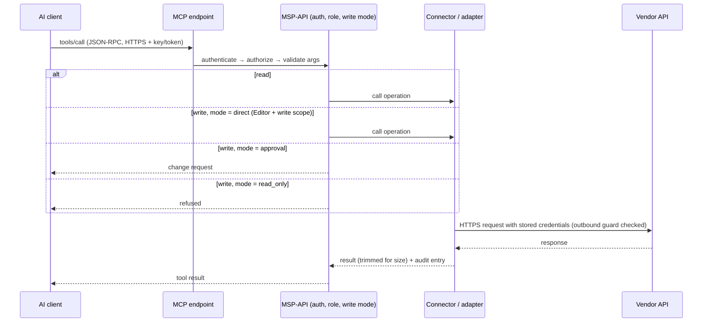

# How MSP-API works

The technical detail behind the [README](../README.md): the request path, the MCP servers, how tools reach vendor
APIs, and the security controls, with the source files for each.

## Request path

```mermaid
flowchart LR
    AI["AI client<br/>(Claude, VS Code, Cursor)"]

    subgraph Server["MSP-API server (FastAPI)"]
        direction TB
        MW["NetworkBoundaryMiddleware<br/>app/security.py"]
        AUTH["Authentication<br/>session · connection key · OAuth token<br/>app/auth/principal.py → resolve()"]
        AUTHZ["Authorization<br/>role rank + scopes + CSRF<br/>_authorize()"]
        MCP["MCP servers<br/>/mcp · /mcp/{connection} · /msp/mcp<br/>app/mcp/ · app/api/org_mcp.py"]
        TOOL["Tool call<br/>role check · argument validation"]
        WM["Write mode<br/>read_only · direct · approval<br/>app/auth/write_mode.py"]
        CHG["Change requests<br/>Editor submits → Approver approves<br/>app/services/changes.py"]
        CONN["API connectors<br/>adapters (any API) · vendor connectors<br/>app/connections/ · app/connectors/"]
        NG["Outbound guard<br/>app/connections/netguard.py"]
        AUD[("Audit log<br/>+ encrypted credentials")]
    end

    VENDOR["External APIs<br/>PSA · Asio · ScreenConnect<br/>SentinelOne · ESET · any API"]

    AI -->|"JSON-RPC over HTTPS"| MW --> AUTH --> AUTHZ --> MCP --> TOOL
    TOOL -->|read| CONN
    TOOL -->|write| WM
    WM -->|direct| CONN
    WM -->|approval| CHG -->|after final approval| CONN
    CONN --> NG --> VENDOR
    TOOL -.-> AUD
    CONN -.-> AUD
```



1. **Network boundary.** Requests whose `Host` isn't a LAN address, a single-label LAN name or the configured edge
   domain are refused, which blocks tunnels. Internet traffic must come through the nginx edge (`X-MSP-Edge: 1`).
   From outside the office, it can reach only the MCP endpoints and OAuth discovery, registration and token endpoints.
2. **Authentication.** Every route except health, sign-in, first-run setup and OAuth discovery needs a caller:
   a browser session, a connection key (`msp_…`) or an OAuth access token. Requests without one get `401`.
3. **Authorization.** Role rank, scopes and CSRF are checked before the route runs.
4. **MCP tool.** The tool validates its arguments and checks the caller's role.
5. **Write mode.** Every write passes the target API's write mode.
6. **Connector.** The request goes out through the connector, after the outbound guard checks the destination.
7. **Audit.** Tool calls and writes are recorded. Arguments are stored as a hash, never in plain text.



## MCP servers

| | |
|---|---|
| **Implementation** | [`app/mcp/protocol.py`](../app/mcp/protocol.py): MCP on JSON-RPC 2.0, with no dependency on the `mcp` SDK. Protocol versions `2025-11-25`, `2025-06-18`, `2025-03-26`, `2024-11-05` |
| **Transport** | Streamable HTTP, **stateless**, JSON responses. `POST` only. `GET`/`DELETE` return `405` (no SSE stream, no sessions). Requests must be `Content-Type: application/json` |
| **Starts with** | The web app itself (`python -m app.cli run`, or the Docker image). There is no separate MCP process |
| **Core servers** | [`app/api/mcp_servers.py`](../app/api/mcp_servers.py) routes. [`app/mcp/servers.py`](../app/mcp/servers.py) builds the tools |
| **MSP server** | [`app/api/org_mcp.py`](../app/api/org_mcp.py), registered by [`app/packs/msp/__init__.py`](../app/packs/msp/__init__.py) (MSP pack only) |
| **stdio bridge** | [`app/mcp/stdio_bridge.py`](../app/mcp/stdio_bridge.py), served at `GET /mcp/bridge.py`, for clients that only start local stdio servers |

| URL | Server | Tools registered in |
|---|---|---|
| `POST /mcp` | **Hub:** every connection your scopes allow | `hub_server()` |
| `POST /mcp/{connection}` | One connection as its own MCP server | `connection_server()` |
| `POST /mcp/{connection}/{group}` | A hand-picked group of that connection's operations | `connection_server(…, group)` |
| `POST /msp/mcp` | The MSP pack's curated tools; org skills as prompts | `TOOLS` in `app/api/org_mcp.py` |
| `GET /api/mcp/servers` | Every server you may use, with ready-to-paste client configs | `app/api/mcp_servers.py` |

`/msp/connect` is the setup page for the MSP server: one-line installers for Claude Code (a plugin with the org
skills from [`app/org_skills/`](../app/org_skills/)), VS Code and Claude Desktop. Recipes and playbooks live in
[`app/org_recipes/`](../app/org_recipes/) and [`app/org_playbooks/`](../app/org_playbooks/).

### How tools reach the APIs

- **Core servers** call `service.call_operation()` ([`app/connections/service.py`](../app/connections/service.py)).
  It checks read scope, validates the arguments against the operation's JSON Schema, applies the write mode, runs
  the adapter for that kind of API and writes the audit record.
- **`/msp/mcp`** calls the app's own REST API **in-process, as the original caller** (`_internal()` with
  `internal_headers()`). The call goes back through the same middleware, so the REST API's role checks apply to AI
  calls exactly as they do to people. The internal header is an HMAC-derived secret, and the middleware rejects it
  if it arrives through the edge.

### Authentication for MCP

| Credential | How it is sent | Notes |
|---|---|---|
| Connection key | `X-API-Key: msp_…` or `Authorization: Bearer msp_…` | Created by an Admin. Role **Reader or Editor only**, never Approver or Admin. Scopes `<connection\|*>:<read\|write>`, optional expiry. Stored as a hash |
| OAuth 2.1 token | `Authorization: Bearer …` | Dynamic client registration, authorization code + PKCE (S256), rotating refresh tokens (access 1 h, refresh 60 days). **Bound to the one MCP server it was issued for** (RFC 8707 `resource`) |
| Browser session | Cookie | For people using the web interface |

Unauthenticated MCP requests get `401` with a `WWW-Authenticate` header pointing at the server's
`/.well-known/oauth-protected-resource` metadata (RFC 9728), so OAuth-capable clients can discover how to sign in.

### Where permissions are enforced

1. **Middleware** (`app/security.py → _authorize`): admin paths need Admin or Approver; connection management
   needs Approver; other non-GET API calls need Editor and a `write` scope.
2. **Scopes** (`Principal.allows`): the core MCP servers list and call only the connections the credential's scopes
   allow, and the MSP pack (`/msp/mcp` and its API) needs a `*:read` or `*:write` scope.
3. **Tool call** (`org_mcp._handle`): `/msp` tools that change data need Editor. Proposal tools are open to all roles.
4. **Write mode and change engine** (`app/auth/write_mode.py`, `app/services/changes.py`).

Every role sees the **same `/msp` tool list**: tools are refused when called, not hidden. Real responses from a demo
install:

```jsonc
// Reader key → tools/call refresh_client_registry
{"result": {"content": [{"type": "text", "text": "refresh_client_registry requires the Editor role"}], "isError": true}}

// Editor key → tools/call refresh_client_registry  (runs)
{"result": {"content": [{"type": "text", "text": "{\"sync\": {}, \"auto_link\": {\"status\": \"no_anchor\", …}}"}], "isError": false}}

// Core-only install (no MSP pack) → POST /msp/mcp
HTTP 404 {"detail": "Not Found"}

// No credential → POST /mcp
HTTP 401
```

## Integrations

### Built-in MSP integrations (MSP pack)

Implemented in [`app/connectors/`](../app/connectors/) and listed as connections of kind `builtin`
([`app/services/builtin_integrations.py`](../app/services/builtin_integrations.py)). Credentials come from the web
interface (stored encrypted) or `.env`.

| Integration | Connector | Authentication method |
|---|---|---|
| ConnectWise PSA (Manage) | `connectwise_psa.py` | HTTP Basic (company + public/private key) and `clientId` header |
| ConnectWise Asio | `asio.py` | OAuth 2.0 client credentials (JSON body) |
| ScreenConnect (RESTful API Manager extension) | `screenconnect.py` | Custom `CTRLAuthHeader` secret |
| SentinelOne | `sentinelone.py` | `Authorization: ApiToken …` |
| ESET MSP Administrator 2 | `eset.py` | Username/password → bearer JWT |
| ESET PROTECT / ESET Connect | `eset_connect.py` | OAuth 2.0 password grant (per-device antivirus detail) |
| Avast Business Hub | `avast.py` | OAuth 2.0 client credentials |

### Any API (core)

Adapters in [`app/connections/adapters/`](../app/connections/adapters/):

| Kind | Source | Operations |
|---|---|---|
| OpenAPI 3 / Swagger 2 | URL, file or pasted text | Every endpoint |
| Postman | Collection v2.0 / 2.1 | Every request |
| cURL | One or more `curl` commands | Each command |
| SOAP | WSDL | Every operation |
| GraphQL | Endpoint (introspection) or schema | Queries and mutations |
| OData | Service URL or `$metadata` (V2, V4) | Entity sets and functions |
| SQL | Connection string | Read-only tables, columns and queries |
| MongoDB | Connection string | Read-only find, count and aggregate |
| MCP | Another MCP server's URL | Its tools, behind this server's sign-in and audit |

**Authentication types** ([`app/connections/http.py`](../app/connections/http.py) `AUTH_TYPES`): none, API key
(header or query), HTTP Basic, bearer token, custom headers, OAuth 2.0 client credentials, OAuth 2.0 password
grant, token login, and WS-Security (SOAP).

**Templates.** About 40 ready-made templates
([`app/connection_templates/templates.yaml`](../app/connection_templates/templates.yaml)) cover the MSP tools plus
Microsoft Graph, Autotask, Halo PSA, NinjaOne, IT Glue, Hudu, Huntress, Pax8, Meraki, Auvik, KnowBe4, Stripe,
HubSpot, Salesforce, Xero, Shopify, Zendesk, Freshdesk, GitHub, GitLab, Jira, Confluence, Slack, Notion, Asana,
Trello and databases. Vendors without a published definition get a small **starter** definition of common read
endpoints. The picker also searches the public [APIs.guru](https://apis.guru) directory, and connection settings
can be exported and imported (never secrets).

## Change requests

[`app/services/changes.py`](../app/services/changes.py)

- A change stores the exact steps and a hash of them. It is refused at approval if the content changed.
- Before running, the current state is read again. If the target changed since the preview, the change is marked
  **stale** and nothing runs.
- Changes rated `delete` require typing `DELETE` when submitting.
- Submit and approve need a **signed-in person** with a CSRF token. Keys and OAuth tokens can't approve.
- Only the requester can cancel a proposed change.

## Security controls

| Control | Where |
|---|---|
| Every route authenticated, including on the LAN | `app/security.py` |
| Network boundary: tunnel/unknown hosts refused; internet traffic only through the edge, limited to MCP + OAuth | `app/security.py` |
| HTTPS only: the app serves TLS itself (local CA until a trusted certificate is installed) | `app/local_run.py`, `app/tls.py` |
| CSRF check on browser-session writes | `app/security.py`, `app/api/auth_m365.py` |
| Rate limits per caller (default 600/min) and per IP on sign-in endpoints (60/min) | `app/auth/ratelimit.py` |
| Vendor credentials encrypted at rest (AES-256-GCM, `MSP_MASTER_KEY`) | `app/auth/crypto.py` |
| Connection keys and OAuth tokens stored as SHA-256 hashes | `app/api/external_auth.py` |
| Local passwords hashed with scrypt; TOTP with replay protection and lockout | `app/auth/passwords.py`, `app/api/auth_local.py` |
| OAuth tokens bound to one MCP server; redirect URIs allow-listed | `app/api/external_auth.py`, `app/security.py` |
| Outbound guard: no link-local or cloud-metadata targets; optional block of private ranges | `app/connections/netguard.py` |
| Audit log of every write and every MCP tool call (arguments hashed) | `app/auth/audit.py` |

Operator guidance: [SECURITY.md](SECURITY.md).

## Example workflows

**"Which machines at Contoso have no antivirus?"** (MSP pack, Reader): `search_clients` → `av_gaps`. The answer
comes from the last antivirus sweep in the server's database. No vendor is called and nothing changes.

**"Show open tickets for this client"** (MSP pack, Reader): `search_clients` → `search_tickets`. A live, read-only
call to ConnectWise PSA.

**"Offboard laptop CON-LT-042"** (MSP pack): `find_workflow` finds the `offboard-device` playbook, and
`propose_change` builds a plan with the exact SentinelOne, Asio and PSA requests and their current state. **Nothing
runs** until an Editor submits it and an Approver approves it in the browser.

**"Create an issue in our GitHub repo"** (any API): on the hub, `search_operations` → `describe_operation` →
`call_operation`. Refused if the connection is `read_only`, a change request if `approval`, run if `direct` and the
caller is an Editor with write scope.

## Repository structure

```text
app/
  main.py                 FastAPI app: core routers, packs, middleware
  security.py             Network boundary, authentication, authorization, audit
  cli.py                  Admin commands (run, create-user, create-key, make-certs, …)
  auth/                   Roles and principals, write modes, encryption, passwords/TOTP, rate limits, audit
  mcp/                    MCP protocol, per-connection and hub servers, stdio bridge
  api/                    HTTP routes (connections, MCP, changes, setup, sign-in, MSP pack features)
  connections/            Any-API engine: adapters, search, local-copy sync, outbound guard
  connectors/             Built-in vendor connectors (PSA, Asio, ScreenConnect, SentinelOne, ESET, Avast)
  services/               Change engine and commands, company matching, reconciliation, templates, TLS
  packs/msp/              The MSP pack: what it registers and starts
  connection_templates/   Connection templates and starter API definitions
  org_skills/ org_recipes/ org_playbooks/   Org library served through /msp/mcp
  static/                 Web interface
alembic/                  Database migrations
deploy/                   Server setup scripts, nginx edge
docs/                     Install, security, architecture, connecting APIs, MCP clients, MCP tool reference
tests/                    Offline test suite (network calls are mocked)
```
